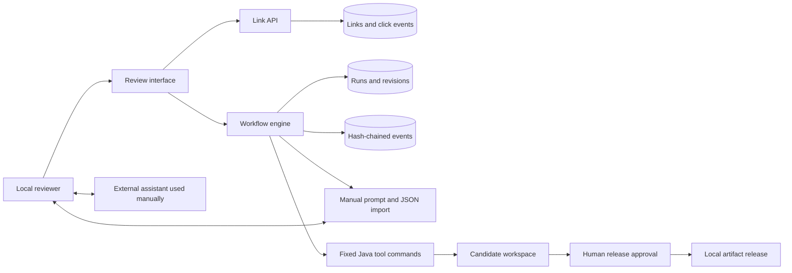
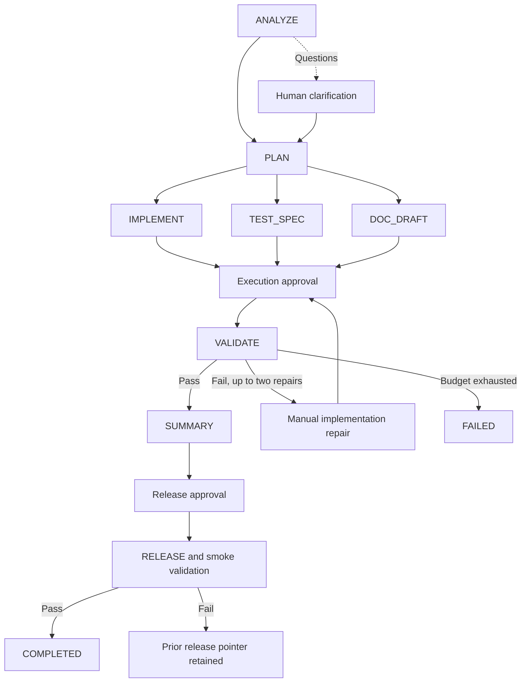

# Architecture

## Components

The application is a Java 17 / Spring Boot 4.1.1 modular monolith. Spring JDBC provides explicit SQL and transaction boundaries. Static HTML, CSS, and JavaScript provide the local review interface without a frontend build. H2 file storage is the verified default; a PostgreSQL configuration is supplied separately.

## Dependency graph and state transitions

TEST_SPEC and DOC_DRAFT use independent worker tasks. Their start events persist before the engine releases its state lock, so the join cannot accidentally depend on branch execution order. They supply deterministic review specifications; CandidateTest contains the actual executable assertions.

ANALYZE, PLAN, and IMPLEMENT pause for structured manual input in manual mode. Demo mode uses explicit authored fixtures. The ambiguous scenario always asks for a real manual implementation after clarification instead of treating an arbitrary answer as a canned implementation.

The graph is fixed by policy. Re-planning a changed root requirement creates a new revision of the graph and archives the prior snapshot. Repair is a non-linear workflow transition back to implementation rather than a cyclic task dependency. The graph remains acyclic within a revision.

## State and concurrency

Run/task snapshots are stored as JSON with a database optimistic version. Separate tables retain prior revisions and ordered audit events. A single engine instance serializes transitions, while at most two workers execute independent tasks. Worker results carry run ID, revision, stage, and artifact hash. Revision and state checks prevent stale results from promoting an artifact.

`WorkflowRepository.save` updates the snapshot and appends its audit event in one database transaction. Archiving an old revision and beginning a new one are not one filesystem/database transaction. A multi-instance deployment would require database leases, a durable queue, and transactional scheduling; this prototype intentionally runs one instance.

On startup, any persisted RUNNING task becomes pending, execution/release approvals clear, and the engine pauses at a new gate where appropriate. It does not assume whether an interrupted subprocess finished successfully.

## Tool boundary

Manual implementation responses provide complete files, not shell commands. The allowlist is `LinkStore.java`, `CandidateTest.java`, `Server.java`, and optional `README.md`. Bundle and file sizes are bounded. Paths are derived from validated run IDs and revisions; symbolic links are rejected.

The executor invokes fixed argument arrays for `javac` and `java`, strips environment variables other than basic runtime path/Windows temp values, captures output, caps returned log text, and kills timed-out processes and descendants. Source hashes are checked before and after validation.

These controls do not confine Java's file, network, or process APIs. A human must review code before execution. Imported source does not itself grant authority. Production execution would use a separate worker sandbox with a read-only image, restricted network, process/resource quotas, and no service credentials.

## Approvals and local release

Execution and release have separate approval records in the audit trail. The request includes revision and candidate SHA-256. Disk hashes must match reviewed content. Rejected approval ends the run. Changed requirements or repair bundles clear approvals.

A release copies the candidate into a revision-specific directory and repeats compilation/tests. After the engine confirms that the run is still active, promotion atomically replaces a per-run local pointer. Failed validation leaves the old pointer unchanged. A crash between pointer replacement and database completion is reconciled through renewed approval, not automatic execution. This is local artifact promotion, not a running-service/cloud deployment.

## URL reliability

The database enforces code uniqueness. Random allocation retries at most five times. Custom alias conflicts return 409. Redirects enforce expiry at the exact boundary and only successful redirects count as clicks. Click events and lookup execute in one Spring transaction. This favors accurate local analytics over serving a redirect during storage failure.

No destination is fetched by the backend. This avoids introducing a server-side fetch/SSRF path. A URL shortener still needs abuse reporting and destination policy before public deployment.

## Audit and metrics

Each event hashes its run ID, sequence, timestamp, type, detail, and predecessor hash. Exports include chain verification. This detects edits against the retained chain, but has no independent trust anchor, truncation proof, or regulatory certification.

Metrics use actual persisted runs: terminal success denominator includes completed, failed, and rejected; latency includes human wait time; retries count repair opportunities; rollbacks count release failures; recovery time sums observed failure-to-next-success intervals. Small demonstration samples do not establish production availability or MTTR.
